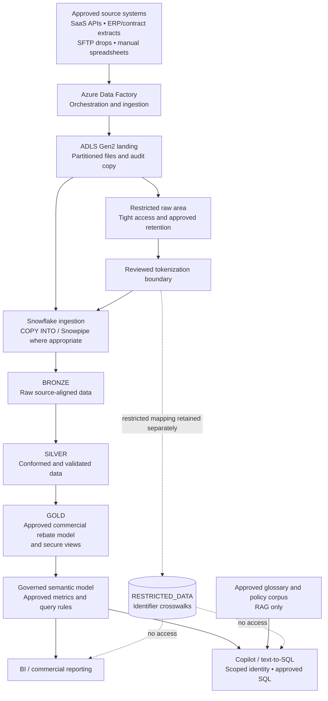

# Governed Rebate Analytics & Copilot

A sanitized, case-study-aligned starter project for a governed commercial rebate analytics platform with a Copilot-style natural-language analytics experience. The repository demonstrates the proposed architecture, security boundaries, illustrative Snowflake SQL, and small Python helpers. It is **not** a deployed or production-ready cloud implementation.

> **Data and confidentiality:** This repository is intended to contain only illustrative code and synthetic examples. Do not commit client data, personal or health information, source extracts, credentials, tokens, keys, connection strings, or environment-specific endpoints. Review the repository before making it public.

## Project overview and scope

### Objective

Create a governed data foundation for commercial rebate reporting and variance analysis, with a Copilot interface that can answer approved business questions using the approved commercial data model. The design separates restricted identifier data from analytical consumption and limits retrieval-augmented generation (RAG) to approved business glossary and policy material.

### In scope for the proposed POC

- **Source ingestion pattern:** Demonstrate the design for selected source feeds such as SaaS APIs, ERP/contract extracts, third-party SFTP drops, and manually supplied spreadsheets. The POC should validate a small representative set of patterns rather than onboard every possible source.
- **Landing and orchestration:** Use Azure Data Factory (ADF) to orchestrate ingestion into Azure Data Lake Storage Gen2 (ADLS Gen2), with source/date partitioning and auditability as design goals.
- **Layered data platform:** Use Snowflake `BRONZE`, `SILVER`, and `GOLD` layers for raw landing, conformed data, and approved commercial analytics respectively.
- **Restricted-data boundary:** Keep identifier crosswalks and other restricted attributes in a separate `RESTRICTED_DATA` area. Apply a reviewed tokenization approach before data is exposed to shared analytical layers.
- **Rebate analytics:** Model commercial rebate measures and variance analysis using an auditable grain. Resolve historical claims against the contract version effective at the claim time; use fixed-precision decimal types for monetary amounts.
- **Governed BI and Copilot:** Expose approved commercial metrics through a governed semantic model or secure views for BI and text-to-SQL/Copilot use. Queries must run under appropriately scoped identities and roles.
- **Business knowledge retrieval:** Limit RAG to approved business glossary and policy content. Do not index restricted identifier data or use this RAG corpus to answer clinical or dosage questions.
- **Security and audit design:** Document least-privilege access, data separation, secret handling, logging, and sanitization considerations.

### Out of scope for this starter / POC

- Clinical decision support, dosage recommendations, or clinical-data interpretation.
- Copilot or BI access to `RESTRICTED_DATA` or direct identifiers.
- Production deployment of Azure resources, ADF pipelines, private networking, or identity federation.
- Fully implemented source-system connectors, operational scheduling, retries, reconciliation, and production data-quality workflows.
- Production tokenization/key management, complete DLP, comprehensive SQL parsing, or a formal security/privacy certification.
- Production Snowflake authentication, Cortex/API integration, Power BI integration, or enterprise semantic-layer deployment.
- A promise of sub-second or real-time freshness for source feeds that arrive in batches or through manual uploads.

The scope above describes the **intended POC design**. Only the code and SQL actually present in this repository are implemented as starter examples; cloud services and integrations are not deployed by this project.

## Architecture

The diagram below shows the target logical architecture represented by the starter project. It is a design view, not a deployment diagram.



### Architecture and security principles

- **Layer separation:** Keep raw, conformed, and consumption-ready data in distinct Snowflake schemas with appropriate access and retention controls.
- **Restricted data stays restricted:** The Copilot and BI identities must not receive grants to `RESTRICTED_DATA`; never index that schema into the RAG corpus.
- **Governed query path:** Copilot requests should use approved metrics/views and run under a scoped user or service role. Application-side checks are not a replacement for Snowflake permissions and policies.
- **RAG has a narrow purpose:** Retrieve approved business glossary and policy material, not unrestricted data or clinical content.
- **Freshness is explicit:** Preserve ingestion timestamps and report an `as_of` timestamp. Do not describe batch or manual feeds as real-time.
- **Historical auditability:** Resolve claims against the contract version that was active when the claim occurred and use fixed-precision monetary values.

For additional design notes, see [`docs/architecture.md`](docs/architecture.md) and [`docs/threat-model.md`](docs/threat-model.md).

## Repository contents

```text
app/                  FastAPI demo, configuration, security and ingestion helpers
sql/                  Illustrative Snowflake schemas, grants and Gold model
 tests/               Unit tests for the starter helpers
docs/                 Architecture, threat model and GitHub sanitization checklist
.github/workflows/    Test workflow
.env.example          Placeholder configuration only
Dockerfile            Minimal container for the demo API
```

## Run locally

Python 3.11+ is recommended. These commands run the demo API locally; they do not provision or connect to Azure or Snowflake.

```powershell
# From the repository root, on Windows PowerShell:
python -m venv .venv
.\.venv\Scripts\Activate.ps1
pip install -r requirements.txt
Copy-Item .env.example .env
uvicorn app.api:app --reload
```

On macOS/Linux, activate the virtual environment with `source .venv/bin/activate` and copy the example configuration with `cp .env.example .env`.

Open `http://127.0.0.1:8000/health` to check the local demo API. Run the tests with:

```bash
pytest -q
```

## Implementation status and limitations

| Capability | Status in this repository |
|---|---|
| Logical architecture and scope documentation | Included |
| Illustrative Snowflake schema, grants, and Gold model SQL | Included; review before use |
| Demo API and helper functions | Included; not production controls |
| Unit-test examples and CI workflow | Included |
| Azure Data Factory pipelines and ADLS provisioning | Not implemented |
| Live source connectors and Snowflake connectivity | Not implemented |
| Production tokenization and key management | Not implemented |
| Production semantic layer, Copilot/text-to-SQL, and RAG integration | Not implemented |
| Entra ID, managed identity, private networking, and production audit setup | Not implemented |
| Power BI or enterprise reporting integration | Not implemented |

The HMAC tokenization helper, regex-based sensitive-data checks, and SQL validation are demonstrations only. They are not substitutes for a reviewed tokenization service, enterprise DLP, a full SQL parser, or database-enforced authorization.

## Before connecting real services

1. Keep the GitHub repository private until the code and documentation have been reviewed for sensitive information.
2. Review [`docs/github-sanitization-checklist.md`](docs/github-sanitization-checklist.md).
3. Enable GitHub secret scanning and push protection where available.
4. Store secrets in Azure Key Vault or an approved CI secret store; never put secrets in source files.
5. Implement identity federation, private networking, storage ACLs, Snowflake RBAC and applicable row-access policies, audit logging, and retention controls.
6. Ask Security/Privacy and the Snowflake administrator to review the tokenization design, grants, and data-flow boundaries before using real data.

## Disclaimer

This is a sanitized demonstration starter based on a case-study architecture. Names, data, and configuration are illustrative. The repository does not represent a completed production system or a guarantee of regulatory compliance, security, data quality, or performance.
